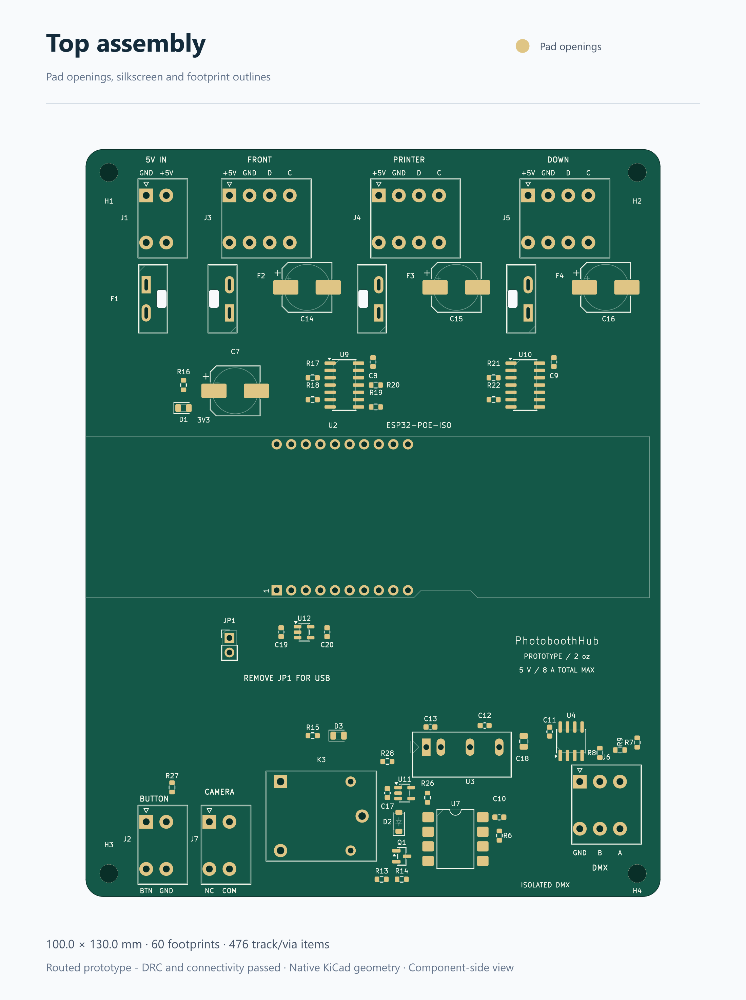

# Routed PCB and layout review

**Routing complete; prototype qualification remains before production.**
Updated 13 September 2026. Electrical and visual checks below apply to the saved
board. They do not establish temperature rise, isolation certification or enclosure fit.

The board contains all 56 schematic components (R9 DNP), four board-only mounting
holes, **391 track segments, 85 vias and five copper zones**. Native KiCad 10 DRC
after refilling and saving the zones reports **0 violations, 0 unconnected items
and 0 schematic-parity issues**. Schematic ERC reports **0 errors / 0 warnings**
with its existing rule configuration. Saved reports are in
[validation](validation/README.md); see also the [copper preview](pcb-routing.png).

## Board and fabrication assumptions

- Proposed carrier outline: **100 × 130 mm**, X=20…120 mm and Y=20…150 mm.
- Proposed M3 carrier-hole centres: (24, 24), (116, 24), (24, 146), (116, 146) mm. Verify screw, washer and standoff envelopes; keep mounting hardware clear of copper on both layers, especially the lower-right hole within the DMX island.
- Two copper layers, **1.6 mm FR-4**, **2 oz finished copper on both sides**; components on the top side. Keep the bottom mostly available for return copper.
  The initial stackup records 0.07 mm copper per side and a 1.44 mm core;
  confirm the fabricator's finished stackup before ordering.
- Ordinary routing: 0.25 mm minimum signal width/clearance, 0.9/0.3 mm via
  diameter/drill, and 0.5 mm copper clearance from board edges and routed cutouts.
  Power and isolation constraints override these ordinary values.
- [JLCPCB capabilities](https://jlcpcb.com/capabilities/pcb-capabilities) list
  0.16 mm minimum width/spacing for two-layer 2 oz boards, 0.5 mm minimum plated
  slots and 1.0 mm minimum nonplated routed slots. Confirm the actual order options.
- Preserve the four fuse-holder retention openings as closed **Edge.Cuts** loops. Their R0.5 corners accommodate a 1 mm router; they are not oval drill holes.

The four M3 carrier holes are 3.2 mm NPTH. Both copper layers have hardware
keepouts: 4 mm radius at H1–H3 and 6.5 mm at H4. The complete hardware envelope,
including possible offset and positioning tolerance, must stay within 3.5 mm
of each hole centre. That leaves 3 mm to isolated copper at H4; a nominal
7 mm washer alone does not guarantee it. Confirm fastener dimensions and fit;
these holes are excluded from the
electrical BOM and placement-file output.

## Power distribution

The design input is **8 A maximum total from the external 5 V supply**. J1 and F1
feed a continuous front-layer bus along the fuse row. The lighting current stays
upstream of U12 and U2. The controller and auxiliary circuits have separate
branches from this bus.

- The front bus is nominally **8 mm wide**, X=26…104, Y=48…56 mm. Inspection of
  its actual filled polygon found one connected region and a **7.525 mm minimum
  cross-section** along the F1-to-F4 path. The small reduction is beside the
  bypass pads. No signal track or via cuts the bus.
- Raw input and each fused output use **2.8 mm tracks on both copper layers**,
  connecting both solder pins of every power-terminal pole. Fuse lands have solid
  copper connections, rear spreading tracks and four nearby vias per fuse. The
  main current is not forced through a single via or thin thermal spokes.
- F2/F3/F4 sit beside J3/J4/J5 and C14/C15/C16. Each bulk capacitor has a 1.2 mm
  charging spur and two ground vias. C7 feeds the controller through a separate
  1 mm route; a 0.75 mm branch feeds the DMX converter/relay circuit. U12 remains
  on the controller branch, with C19/C20 and removable JP1 nearby.
- The six lighting data/clock outputs use short back-layer bridges across the
  bus, then return to the front layer above it. This leaves the broad rear ground
  return available between the input and lighting terminals. Each buffer and
  bypass capacitor has a nearby ground via.
- A named rule area, **Main 5V bus routing guard**, and custom DRC rule reject
  foreign front-layer tracks and through vias in X=25.75…104.25,
  Y=47.75…56.25 mm. A temporary witness board confirmed four deliberately
  introduced violations; +5 V copper and back-layer signal tracks were allowed.
- Integrating the filled bus cross-section at 70 µm copper and 20 °C gives about
  **2.05 mΩ** from F1 to F4, or 16.4 mV at 8 A. This is a copper-only resistance
  estimate, excluding fuse/contact resistance, pad transitions, cables and heating;
  it is **not a temperature-rise or fuse-protection rating**.
- Primary +5 V must remain within **4.75–5.25 V at the board under load**.
  Confirm supply tolerance, cable drop, branch current and startup behavior on
  the assembled prototype before selecting the four fuse ratings.

J7's two floating camera contacts run to K3's **NC and common** pins on 2 mm
tracks on both faces. Q1's emitter has a dedicated 0.4 mm ground path and via;
U11's ground has its own 0.3 mm path and via. The camera circuit does not connect
to primary or DMX ground. The relay's headline current rating does not establish
its NC-contact DC rating; qualify it against the actual camera supply/load/inrush.

## Isolated DMX region

The routed DMX island occupies the lower-right region. Its **L-shaped copper keepout** consists of a vertical strip **X=82.85…85.85, Y=116.5…150 mm** and a horizontal strip **X=82.85…120, Y=116.5…119.5 mm**, on both copper layers. U3 and U7 straddle the vertical boundary at X=84.35 mm, with primary connections on the left.

- Use **3.0 mm minimum primary-to-DMX copper separation** as the initial
  functional-isolation layout assumption. Keep the separation on every copper layer;
  no primary traces, vias, pours or mounting hardware may bridge into the island.
- Enforce 3 mm between the `DMX_Isolated` netclass and other connected nets; retain 0.25 mm ordinary clearance within the island. Empty-net NC pads retain ordinary clearance. The horizontal keepout closes the upper end so a pour cannot wrap around the vertical strip.
- Primary GND and DMX-GND are separate copper regions. Never pour primary ground
  beneath the isolated supply output, optocoupler output, U4 or J6.
- U3's native footprint has only **3.58 mm** between the closest input/output pad
  edges; U7 has **7.53 mm** between pad rows. The 3 mm assumption fits these parts;
  a greater specified insulation requirement would need another review.
- U4, its bypass capacitor, bias resistors and J6 are grouped within the isolated
  island. A/B are routed together on the front layer; R9 remains DNP. Both
  isolated ground layers are filled, with local stitching at the bypass returns.

## Local decoupling and signal placement

| Components | Placement constraint |
|---|---|
| C10 / U7 | At U7 pins 8 and 5, entirely on the isolated side. |
| C11 / U4 | At U4 pins 8 and 5, with the shortest practical supply/return loop. |
| C12, C18 / U3 | Immediately beside the isolated output pins. |
| C13 / U3 | Immediately beside the primary input pins. |
| C17 / U11 | At U11 supply/ground; keep R26 and the optocoupler LED loop short. |
| C19, C20 / U12 | Beside input/output and ground pins on the controller feed. |
| C8/C9 / U9/U10 | 100 nF, 0603; short supply spurs and ground vias immediately below the main bus. |

[TI's THVD1500 layout guidance](https://www.ti.com/lit/ds/symlink/thvd1500.pdf)
calls for local 100 nF bypassing and low-inductance supply/ground connections.
Use short ground connections and multiple vias when a bypass loop changes layers. If external transient protection is added later, place it at J6 in the signal path.

## Module and service access

U2 is rotated 90°, with origin (53.22, 96.71) mm: **antenna left, Ethernet right**.
The module PCB occupies **X=20…118.15, Y=70…98 mm**. Its antenna assembly extends left to **X=13.614 mm** and RJ45 body right to **X=126.293 mm**: the assembly spans approximately **112.7 mm**, before enclosure and cable clearances. These overhangs extend beyond the carrier outline.
[Espressif recommends](https://docs.espressif.com/projects/esp-hardware-design-guidelines/en/latest/esp32/pcb-layout-design.html)
antenna overhang and at least 15 mm antenna clearance in the finished product.
Keep copper, components, cabling and enclosure metal away from the antenna region.

The board reserves a copper-free antenna rectangle at X=20…35 mm,
Y=59.46…108.56 mm on both layers. A second copper keepout under the module's
power/Ethernet end, X=78…119.5 mm and Y=69.5…99.5 mm, conservatively avoids
carrier copper below that area until socket/standoff separation is confirmed.
It is a project layout precaution, not a certified module insulation rating.

Reserve **X=76…91, Y=98…117 mm** for USB service access; confirm the actual plug and cable fit. Keep the right-hand RJ45 plug/latch approach accessible. The module hole marks are guides, not carrier holes. Select socket height and standoffs before
placing components underneath the module. Top-entry terminals need wire-bend and
screwdriver access; fuse holders need overhead clearance for removal, not merely
the estimated 17.5 mm installed height. Terminal installed height is 14.4 mm.

## Self-review and remaining qualification

The saved assembly and copper previews were visually inspected for connector
ordering, readable legends, component spacing, polarity and service access. All
connector poles now have wiring labels; the 5 V input's GND/+5 V order is
explicitly distinguished from the lighting outputs' +5 V/GND/D/C order. J7 is
marked NC/COM and J6 GND/B/A. The USB shunt-removal instruction remains visible.
Silkscreen height is at least 0.8 mm, and native checks report no silk overlaps.

An independent comparison checked all 56 schematic references, 59 nets and 185
electrical pin nodes against the placement checkpoint. Connectivity is unchanged;
only C8/C9 sourcing/value changed to the common 100 nF part. Every PCB pad net,
including duplicated Phoenix solder pins, matches the schematic. Filled copper,
power-bus continuity, ground-via attachments and the camera contact routes were
reviewed separately from the DRC result.

The custom isolation rule was also checked on a separate temporary witness
board with the same project settings: all four isolated-net patterns enforced
3 mm to primary copper, while internal isolated pairs accepted 0.25 mm.
All five deliberately introduced clearance violations were detected. This
checks the rule configuration, not the insulation performance of an assembly.

- Rerun DRC with zone refill and schematic parity after any PCB/schematic edit;
  preserve the bus guard, isolation rules and reviewed power widths.
- Confirm branch currents/fuses, copper temperature rise, supply drop and startup
  behavior; test the assembled prototype at the maximum intended load.
- Check sockets, standoffs, antenna/connector access and enclosure dimensions with
  physical parts. Test a fuse-holder coupon for retention fit and routing tolerances.
- Inspect fabrication previews for every plated slot, routed opening and board edge.
  Confirm through-hole soldering access, assembly handling and part availability.

Related records: [assembly BOM](assembly-bom.md), [module footprint](../FOOTPRINTS.md),
[terminal footprints](phoenix-spt-footprints.md), [compact fuses](compact-fuses.md),
[remaining footprints](remaining-component-footprints.md), [schematic review](../REVIEW.md).
